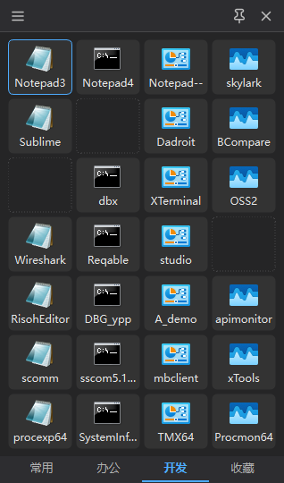
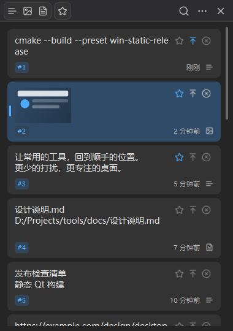
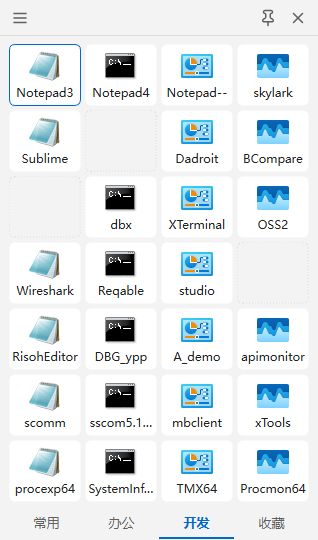
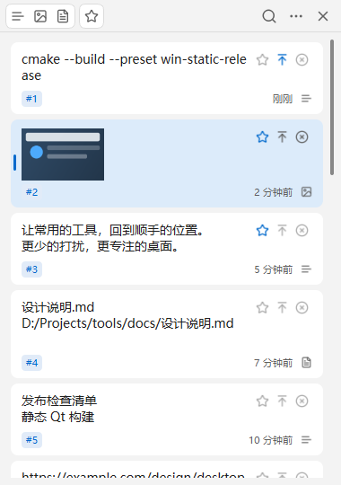
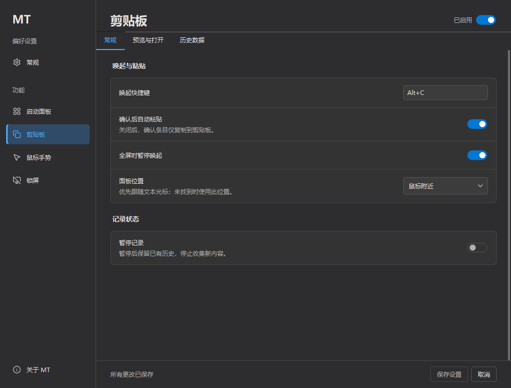
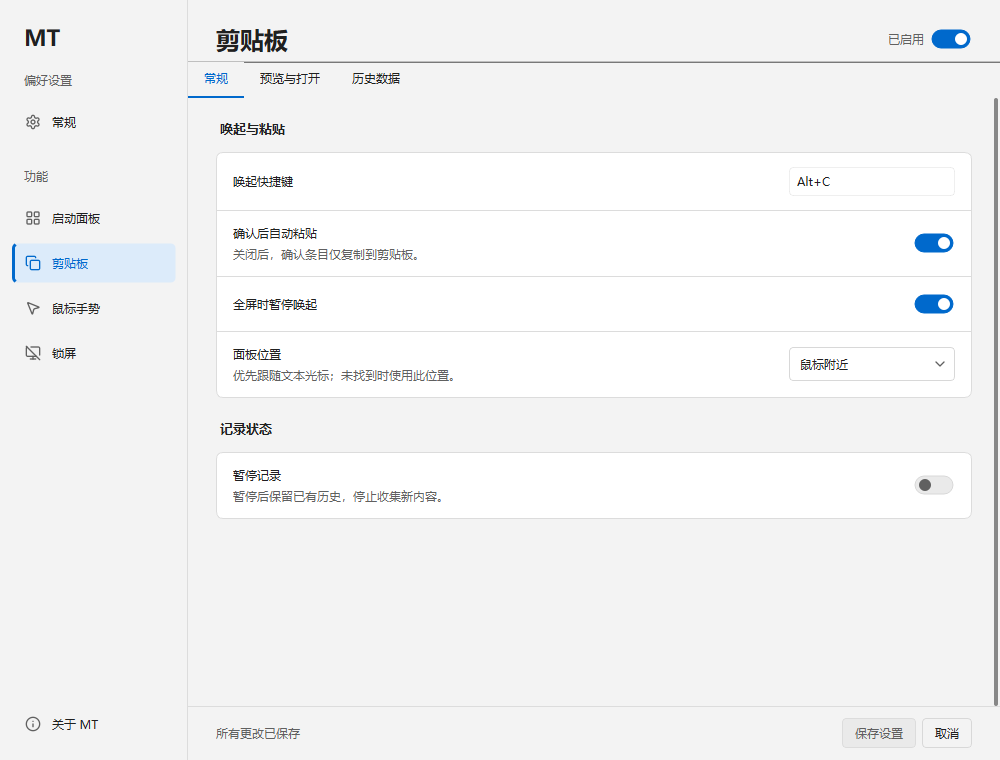

<p align="center">
  
</p>

<h1 align="center">MT</h1>

<p align="center">一个 Windows 桌面工具，集启动面板、剪贴板历史、鼠标手势与锁屏于一体。<br>单 EXE · 免安装 · 中文界面</p>

<p align="center">
  <a href="https://github.com/Hunlongyu/mt/releases/latest"></a>
  <a href="https://github.com/Hunlongyu/mt/releases"></a>
  <a href="https://github.com/Hunlongyu/mt/actions/workflows/windows.yml"></a>
  <a href="LICENSE"></a>
</p>

<p align="center">
  <a href="https://github.com/Hunlongyu/mt/releases/latest">下载</a> ·
  <a href="#界面预览">界面预览</a> ·
  <a href="#快速上手">快速上手</a> ·
  <a href="https://github.com/Hunlongyu/mt/releases">更新日志</a> ·
  <a href="https://github.com/Hunlongyu/mt/issues">问题反馈</a>
</p>

## 下载与运行

前往 **[最新正式版](https://github.com/Hunlongyu/mt/releases/latest)**，下载 `mt-<版本>-windows-x64.zip`，解压到固定目录后运行其中的 EXE。便携包包含程序与第三方许可证，无需安装 Qt 或额外的运行库。

- **单文件程序**：也可从同一发布页直接下载 EXE；程序与配置、历史数据分开保存。
- **系统与架构**：目前提供 Windows x64 构建，主要开发验证环境为 Windows 11 x64；其他系统版本、架构与跨机器兼容性仍待验证。
- **文件校验**：发布页提供 `SHA256SUMS.txt`，可用于核对下载文件。

程序文件名从 v0.1.1 起统一为 `mt.exe`；v0.1.0 使用 `mt-windows-x64.exe`。**从 v0.1.0 升级时需手动下载一次新版本**，退出旧版后替换程序并保留原数据目录。

## 四项常用功能

| 功能 | 可以做什么 |
| --- | --- |
| **启动面板** | 按分类管理程序、文件、文件夹与网址；支持拖放、搜索、快捷键和边缘唤起。默认 4 列 × 7 行，可调整行列数 |
| **剪贴板历史** | 保存文字、HTML、RTF、图片和文件列表；支持搜索、类型筛选、收藏、置顶、预览、回贴与纯文本粘贴 |
| **鼠标手势** | 按住鼠标右键绘制轨迹，执行按键或窗口操作；支持程序规则，显示轨迹与动作名称 |
| **锁屏** | 遮挡全部显示器，支持简单解锁、密码解锁与暂停；仅遮挡屏幕，不代替 Windows 账户锁定 |

四项功能共用一个托盘和设置窗口，可分别启停。界面提供浅色、深色、跟随系统及面板不透明度设置；登录自启与管理员窗口支持按需开启。

## 界面预览

以下为 v0.1.1 原生界面的示例数据预览。

| 启动面板 · 深色 | 剪贴板历史 · 深色 |
| :---: | :---: |
|  |  |

<details>
<summary>查看浅色主题</summary>

| 启动面板 · 浅色 | 剪贴板历史 · 浅色 |
| :---: | :---: |
|  |  |

</details>

<details>
<summary>查看统一设置</summary>

**深色主题**



**浅色主题**



</details>

## 快速上手

1. 启动程序后，通过系统托盘图标打开面板或进入“设置”。默认隐藏主面板，可直接按快捷键唤起。
2. 按 `Alt+Space` 打开启动面板，添加常用项目；按 `Ctrl+F` 或直接输入文字搜索所有分类。
3. 复制内容后，按 `Alt+C` 打开剪贴板历史，选择记录回贴；常用内容可收藏或置顶。
4. 在设置中按需启用鼠标手势与锁屏，并配置动作或解锁方式。

| 默认快捷键 | 操作 |
| --- | --- |
| `Alt+Space` | 唤起启动面板 |
| `Alt+C` | 唤起剪贴板历史 |
| `Alt+L` | 锁屏，需先启用该功能 |

快捷键可在对应设置页修改。鼠标手势、锁屏、开机启动和管理员窗口支持默认关闭。

## 更新、数据与系统集成

**软件更新**：进入“设置 → 关于 MT”检查和下载更新，确认后安装并重启。后台也会检查正式版本，预发布版不进入自动更新通道。

**数据保存**：新安装默认使用 `%LOCALAPPDATA%\dev.hly.com\mt`，数据独立于 EXE。若新目录尚不存在，而旧目录 `%LOCALAPPDATA%\HunlongyuDevelopment\mt` 已有数据，则继续使用旧目录。需要自定义目录时运行：

```powershell
./mt.exe --data-dir D:/MT-data
```

**旧数据导入**：在“设置 → 剪贴板”导入 Hopy 历史，在“设置 → 启动面板”导入 HLaunch 分类与启动项。源文件只读，数据合并到 MT；不迁移旧工具的偏好、密码或自启项。

**登录自启与管理员窗口**：在“设置 → 常规”中开启。自启仅管理 MT 自身；管理员窗口支持需要确认 Windows UAC 提示，取消后仍可使用普通窗口功能。

格式保留范围、导入限制和数据库恢复见[系统集成与数据](docs/system-integration.md)，更新与回退细节见[更新说明](docs/updating.md)。真实跨版本在线更新、管理员窗口交互、混合 DPI/多屏和真实旧数据导入等仍需扩大验证，详见[开发状态](docs/development.md)。

## 反馈与开发

遇到问题或有改进建议，请提交 [Issue](https://github.com/Hunlongyu/mt/issues)，附上 MT 版本、Windows 版本、复现步骤和必要截图。

项目使用 C++23、Qt 6 Widgets 和 CMake，静态链接 Qt 与 CRT。开发者可查看[本地构建与项目结构](docs/development.md#本地构建)和[发布流程](docs/releasing.md)。

## 许可

自有源码采用 [MIT 许可证](LICENSE)。Qt、Lucide、WIL 等保留各自许可，见[第三方声明](THIRD_PARTY_NOTICES.md)。Release 提供对应依赖源码、许可证和重建材料，支持修改 Qt 后重新链接。
